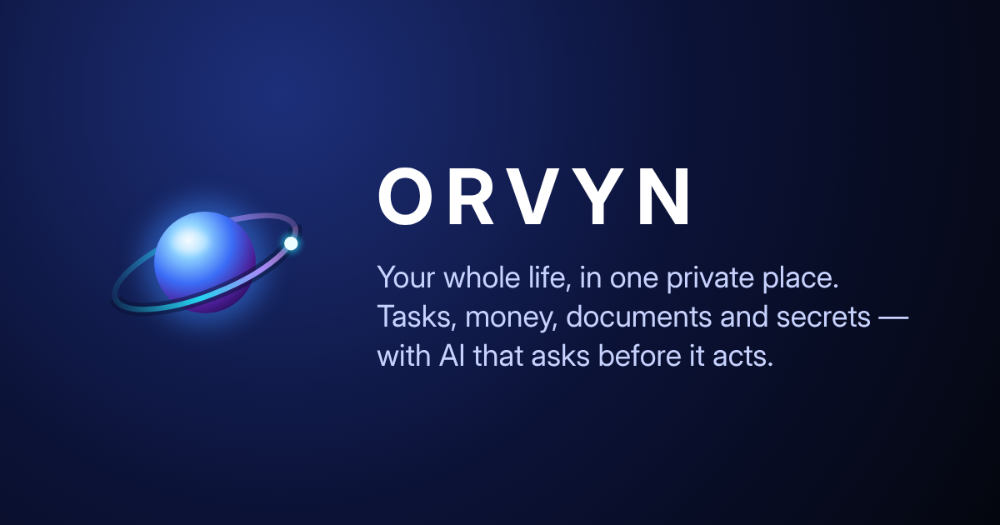
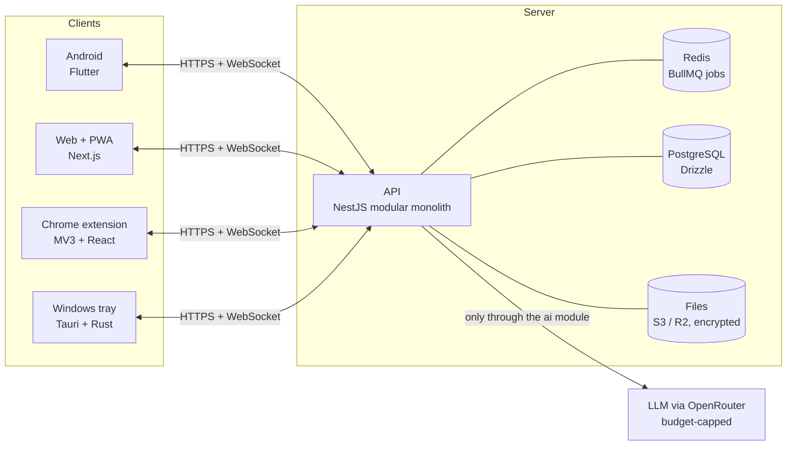

<div align="center">



# ORVYN

**A self-hosted personal operating system.**<br/>
Tasks, calendar, money, documents, passwords, chat and your browsing day: one private app on Android, web,
Chrome and Windows, with an AI that asks before it acts.

[](LICENSE)
[](https://github.com/shubham-dube/ORVYN/releases/latest)
[](#-get-it)
[](CONTRIBUTING.md)
[](https://github.com/shubham-dube/ORVYN/stargazers)

[**Website**](https://orvyn.dubey.app) · [**Download**](#-get-it) · [**Run it yourself**](#-run-it-yourself) ·
[**How it's built**](#-how-its-built) · [**Docs**](docs/README.md) · [**Contribute**](CONTRIBUTING.md)

</div>

---

## Why ORVYN?

Most of us run our lives across a to-do app, a calendar, an expense tracker, a notes app, a password manager, a
drive and a chat app. None of them know about the others, and every one of them wants you to fill in a form.

ORVYN puts all of it in one place you own, and makes capture effortless:

- **Drop anything in.** A receipt photo, a voice note, a screenshot, a PDF, a link. ORVYN works out whether it's an
  expense, a task, an event or a document, fills in the details, and waits for your one-tap yes.
- **Money tracks itself.** On Android, bank SMS and UPI payment notifications become transactions, read **on the
  phone**. Only the parsed transaction is uploaded, never the raw message unless you opt in.
- **One assistant across everything.** _"What did I spend on food this month, and move the dentist to Friday?"_ is
  one request. It shows what it's about to change and never moves money, sends messages or deletes on its own.
- **Your secrets stay secret.** The Vault is zero-knowledge: encrypted on your device with a passphrase the server
  never sees.
- **Yours to run.** Open source under AGPL-3.0. Run it for yourself, then invite family or friends and choose
  exactly which features each person gets.

> [!NOTE]
> ORVYN is young (v0.2) and used daily by its author. The hosted instance at
> [orvyn.dubey.app](https://orvyn.dubey.app) is **invite-only**; to use ORVYN today, [run your own](#-run-it-yourself).
> Expect fast changes, and please [open an issue](https://github.com/shubham-dube/ORVYN/issues) when something breaks.

## ✨ Features

| Module                  | What it does                                                                                                                                        |
| ----------------------- | --------------------------------------------------------------------------------------------------------------------------------------------------- |
| 📅 **Today**            | Tasks and events on one timeline. Type _"pay rent every 1st"_ or _"dentist fri 11 for 45m"_. Auto-plan into free time. Google Calendar two-way sync |
| 📥 **Drop**             | One universal inbox: text, voice, photo, screenshot, file, link. AI proposes what it is; you confirm or correct, and it learns                      |
| 💸 **Money**            | Automatic capture from bank SMS and UPI apps (on-device), statement import, clean merchant names, budgets, subscriptions, monthly story             |
| 🔐 **Vault**            | Passwords, cards, IDs, recovery codes. Argon2id + XChaCha20-Poly1305 via libsodium. Fills logins in Chrome; printable recovery kit                  |
| 📚 **Library**          | Any file, read (OCR), named, tagged and filed by itself. Expiry dates become reminders. _"my PAN card"_ finds it                                    |
| 🤖 **Assistant**        | Chat over all your modules, with sources. Proposes changes and waits for your confirmation. Never sees the Vault                                    |
| 💬 **Chat + Split**     | Chat with the people on your server, share live cards, split expenses in groups                                                                     |
| ☀️ **Brief**            | A morning summary of your day, money, expiring things and decisions waiting. Quiet by default                                                       |
| 📈 **IPO desk** (India) | Open and upcoming IPOs, live subscription, an AI analyst that reads the prospectus. Analysis, not advice; it never applies for you                  |
| 🧭 **My Day + Recall**  | Where your day went across browser and PC. Find _"that page I read on Tuesday"_; page text stays on your device                                     |
| 🖥️ **PC companion**     | Windows tray app: notifications, quick capture, and an end-to-end encrypted terminal to your PC from your phone                                     |

Every feature is a **module** that can be switched on or off **per person**, enforced by the server rather than by
hiding buttons.

### The Chrome extension

Keep, fill and find anything on the web, from any page:

- **Magic fill**: fills any form from your profile. The AI sees field _labels_, never your values. Nothing is
  submitted for you.
- **Vault logins**: pick a login in the popup and one click fills it. Offers to save new sign-ins. Generates
  passwords.
- **Address bar**: `o call mom 6pm` → Today · `o spent 240 lunch` → Money · `o ?passport` → Library.
- **Page brain**: summarise, ask, or compare open tabs, only when you click. Sign-in and banking pages are never read.
- **Plus**: right-click to Drop, side panel, tab stash, focus shield, price history, shortcuts (`Alt+Shift+O/D/F`).

## 🔒 Privacy, stated plainly

| What                        | How it's protected                                                                                                                                                                                                                                                                                    |
| --------------------------- | ----------------------------------------------------------------------------------------------------------------------------------------------------------------------------------------------------------------------------------------------------------------------------------------------------- |
| Vault                       | End-to-end. The server stores only ciphertext, item ids, sizes and times. Lose the passphrase _and_ the recovery kit and it's gone, for us too                                                                                                                                                        |
| PC terminal                 | End-to-end, with a per-device key shown once on the PC. The server only forwards opaque messages                                                                                                                                                                                                      |
| Files, chat, activity       | Encrypted at rest with keys kept in the server's environment, not the database, so a copied database reveals nothing. The running server can read them (for search, previews and summaries), as [ADR-0016](docs/adr/0016-chat-at-rest.md) and [ADR-0018](docs/adr/0018-activity-record.md) say openly |
| Bank SMS                    | Parsed on the phone. Only the transaction is uploaded                                                                                                                                                                                                                                                 |
| AI                          | Content is treated as data, never instructions. No action on money, messages or deletion without your yes. Daily cost cap                                                                                                                                                                             |
| Other people on your server | Every query is scoped to its owner, with a test for this in each module. Sharing only through explicit share objects                                                                                                                                                                                  |

No home-made cryptography: only audited libraries, listed in [security.md](docs/architecture/security.md).
Found a weakness? See [SECURITY.md](SECURITY.md).

## 📲 Get it

Every release ships ready-to-install builds:

| Platform           | Get it                                                                                                                                                                                            |
| ------------------ | ------------------------------------------------------------------------------------------------------------------------------------------------------------------------------------------------- |
| Web + iPhone (PWA) | Open your server's web address and _Add to Home Screen_                                                                                                                                           |
| Android            | [`orvyn-android.apk`](https://github.com/shubham-dube/ORVYN/releases/latest/download/orvyn-android.apk)                                                                                           |
| Windows            | [`orvyn-windows-setup.exe`](https://github.com/shubham-dube/ORVYN/releases/latest/download/orvyn-windows-setup.exe)                                                                               |
| Chrome             | [`orvyn-chrome-extension.zip`](https://github.com/shubham-dube/ORVYN/releases/latest/download/orvyn-chrome-extension.zip): unzip, then `chrome://extensions` → Developer mode → **Load unpacked** |

The release builds connect to `orvyn.dubey.app`. To get the same apps for **your** server, see
[Build the apps for your server](#build-the-apps-for-your-server).

## 🚀 Run it yourself

### On your PC in five minutes

Needs Node 22+, pnpm 10 and Docker.

```bash
git clone https://github.com/shubham-dube/ORVYN.git && cd ORVYN
pnpm install
pnpm setup:local you@example.com   # writes .env: you become the owner, with fresh secrets
pnpm db:up                         # Postgres + Valkey in Docker
pnpm build && pnpm dev             # web on :3000, API on :4000
```

Open <http://localhost:3000> and sign in with that email. Without an email service, the one-time code is printed in
the `pnpm dev` console. AI features work without a key using `AI_PROVIDER=fake`. Android, the extension and the
Windows app: see [run-locally.md](docs/guides/run-locally.md).

### On a server

| Option                                 | Good for                                                                                  | Guide                                                   |
| -------------------------------------- | ----------------------------------------------------------------------------------------- | ------------------------------------------------------- |
| **Docker Compose, all-in-one**         | A small VPS. Postgres, Redis, Caddy, encrypted nightly backups with a weekly restore test | [deploy.md](docs/guides/deploy.md) · [`infra/`](infra/) |
| **Free tier: GCP e2-micro + Supabase** | Close to zero cost. What the author runs                                                  | [`infra/gcp/deploy.sh`](infra/gcp/deploy.sh)            |

Then invite people: **People → Invites**, choose their modules, send the link.

### Build the apps for your server

Fork the repo, set two repository variables (**Settings → Secrets and variables → Actions → Variables**):

```
ORVYN_API_URL = https://api.your-domain.com
ORVYN_WEB_URL = https://your-domain.com
```

Push a tag such as `v0.1.0`. The [Release workflow](.github/workflows/release.yml) builds the Android APK, the
Windows installer and the Chrome extension pointed at your server and attaches them to a GitHub Release.

## 🧱 How it's built



| Layer     | Stack                                                                                |
| --------- | ------------------------------------------------------------------------------------ |
| API       | NestJS, Drizzle ORM, PostgreSQL, BullMQ on Redis/Valkey, WebSockets                  |
| Web       | Next.js, React, Tailwind, installable PWA with web push                              |
| Android   | Flutter, offline-first sync, on-device SMS and notification parsing, FCM             |
| Extension | Chrome Manifest V3, React, Vite                                                      |
| Windows   | Tauri (Rust), native toasts, encrypted terminal                                      |
| Shared    | TypeScript contracts, design tokens → CSS + Dart, libsodium crypto, pnpm + Turborepo |

```
apps/
  api/          NestJS backend, one folder per module (today, money, vault, drop, assistant, …)
  web/          Next.js web app + PWA
  mobile/       Flutter app
  extension/    Chrome extension
  desktop/      Windows tray companion (Tauri)
packages/
  contracts/      API schemas shared by every client
  design-tokens/  one source of truth for colour, type and motion
  vault-crypto/   Vault encryption (libsodium), with shared test vectors
  sync-client/    offline-first sync engine
  activity/ money/ library/ today-parse/ today-plan/   logic shared by server and clients
docs/           vision, architecture, ADRs and specs
infra/          Docker Compose, deploy scripts, backups
```

### Built in the open, decisions included

ORVYN is written **docs-first**: every feature starts as a spec, and every significant choice is an Architecture
Decision Record. You can read _why_ things are the way they are:

- 📐 **[24 feature specs](docs/specs/)** with acceptance criteria
- 🧭 **[19 ADRs](docs/adr/)**: stack, auth, zero-knowledge vault, offline sync, AI gateway, hosting…
- 🗺️ **[Vision](docs/product/vision.md)** · **[Features](docs/product/features.md)** · **[Roadmap](docs/roadmap.md)**
- 🤖 **[AGENTS.md](AGENTS.md)**: the rules for AI coding agents (and humans) working in this repo

## 🤝 Contributing

Contributions are very welcome: bug reports, docs, fixes, new modules, or a smoother first-run experience.
Start with [CONTRIBUTING.md](CONTRIBUTING.md), then look for
[`good first issue`](https://github.com/shubham-dube/ORVYN/issues?q=is%3Aopen+label%3A%22good+first+issue%22).

## ⭐ Support the project

If ORVYN is useful to you, or you just like the idea of a personal OS you own, **star the repo**. It's the
simplest way to help more people find it.

<a href="https://star-history.com/#shubham-dube/ORVYN&Date">
  
</a>

## 🔗 Related

- [JobOS](https://github.com/shubham-dube/jobos): a job-search autopilot that ORVYN shows inside its Jobs module.

## 📄 License

[GNU AGPL-3.0](LICENSE). You may use, change and self-host ORVYN freely. If you run a modified version as a service
for others, you must share your changes under the same license.
